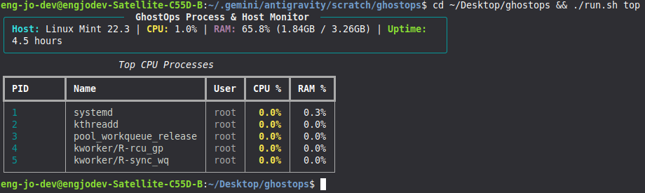
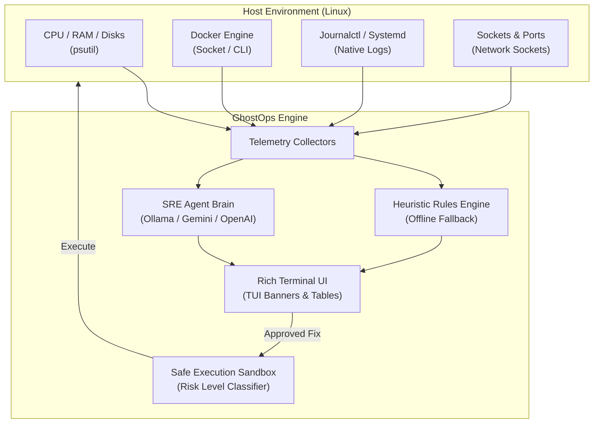

<div align="center">

```
   ________  ______  _____ ______ ____  ____  _____
  / ____/ / / / __ \/ ___//_  __// __ \/ __ \/ ___/
 / / __/ /_/ / / / /\__ \  / /  / / / / /_/ /\__ \ 
/ /_/ / __  / /_/ /___/ / / /  / /_/ / ____/___/ / 
\____/_/ /_/\____//____/ /_/   \____/_/    /____/  
```

# ⚡ GhostOps
### The Autonomous Terminal SRE & DevOps Copilot for Linux Systems

[](LICENSE)
[](https://www.python.org/downloads/)
[](#)
[](#contributing)

*Diagnose kernel issues, crash loops, memory leaks, and broken Docker containers in seconds—with automated, safe, human-in-the-loop self-healing.*

[Quickstart](#-quickstart) • [Features](#-key-features) • [Architecture](#-architecture) • [Security Sandbox](#-security--safety-sandbox) • [Roadmap](#-roadmap)

<br/>



---

</div>

## 💥 The Problem
When a Linux production server or development workstation degrades:
- Containers exit with cryptic status codes (`255`, `137 OOMKilled`).
- Memory leaks trigger silent kernel panics.
- Unreaped zombie processes pollute system tables.
- Engineers lose hours digging through unindexed `journalctl`, `dmesg`, and `syslog` output.

**GhostOps** acts as an on-call Senior Staff Site Reliability Engineer embedded directly in your terminal. It monitors vital telemetry in real-time, pinpoints root causes, and generates verified bash remediations you can execute with a single keystroke.

---

## 🚀 Key Features

* **🩺 Autonomous SRE Doctor (`ghostops doctor`):** Scans CPU saturation, memory pressure, disk volume limits, failed systemd units, and crashed Docker containers.
* **🛡️ Sandboxed Self-Healing (`--fix`):** Proposes exact, syntax-checked bash remediation commands with automatic risk scoring (`SAFE`, `CAUTION`, `DANGEROUS`). Destructive commands (`rm -rf /`, `mkfs`) are strictly blocked.
* **🔒 100% Offline & Private:** Fully supports local Ollama models (`llama3`, `deepseek-r1`, `mistral`) so sensitive infrastructure logs never leave your machine. Also supports Google Gemini and OpenAI.
* **📊 Live Terminal Monitor (`ghostops top`):** High-speed telemetry dashboard showing top CPU hogs, RAM consumption, and container statuses in a stylish TUI.
* **💬 Context-Aware Linux Copilot (`ghostops ask`):** Ask natural language questions like *"Why is port 5432 refusing connections?"* and get answers contextualized with your host's live socket states.

---

## 📦 Quickstart

### Installation

```bash
# Clone the repository
git clone https://github.com/EngJoDev/ghostops.git
cd ghostops

# Create virtual environment & install
python3 -m venv .venv
source .venv/bin/activate
pip install -e .
```

### Basic Usage

#### 1. Run Host Health Diagnostic
```bash
ghostops doctor
```

#### 2. Run Interactive Self-Healing (Suggest & Fix Issues)
```bash
ghostops doctor --fix
```

#### 3. View Live Resource Consumption
```bash
ghostops top
```

#### 4. Ask SRE Questions with Host Context
```bash
ghostops ask "Why did my nginx container exit?"
```

#### 5. Configure Your LLM Provider
```bash
# Option A: Use Local Ollama (Default, Free & Private)
ghostops config --provider ollama --model llama3:latest

# Option B: Use Google Gemini API
ghostops config --provider gemini --api-key YOUR_GEMINI_API_KEY

# Option C: Use OpenAI / Groq / OpenRouter
ghostops config --provider openai --api-key YOUR_KEY --model gpt-4o-mini
```

---

## 🏛 Architecture



---

## 🛡️ Security & Safety Sandbox

Safety is built into GhostOps from the ground up:
* **Strict Command Classification:**
  * 🟢 **SAFE:** Read-only inspection commands (`cat`, `df`, `ps`, `docker logs`)
  * 🟡 **CAUTION:** Service restarts and cache clear operations (`systemctl restart`, `docker restart`)
  * 🔴 **DANGEROUS:** Process terminations and firewall modifications (`kill -9`, `iptables`)
  * ⛔ **FORBIDDEN:** Destructive patterns (`rm -rf /`, `mkfs`, raw disk overrides) are permanently blocked.
* **Human-in-the-Loop:** GhostOps never executes destructive actions without explicit user confirmation.

---

## 🧪 Testing

Run the test suite:
```bash
python3 -m unittest discover tests
```

---

## 🗺 Roadmap
- [x] Native Linux telemetry & process diagnostics
- [x] Docker container crash-loop detection
- [x] Offline heuristic safety net
- [x] Ollama, Gemini, and OpenAI LLM backends
- [x] Command risk classifier and sandbox
- [ ] Kubernetes / Pod troubleshooting collector (`ghostops k8s`)
- [ ] eBPF network latency & packet drop tracer
- [ ] GitHub Action for CI/CD runner self-healing

---

## 🤝 Contributing
Contributions are warmly welcomed! Please check out [CONTRIBUTING.md](CONTRIBUTING.md) to get started.

## 📄 License
This project is licensed under the [MIT License](LICENSE).

